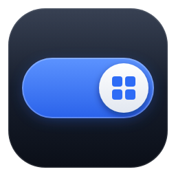
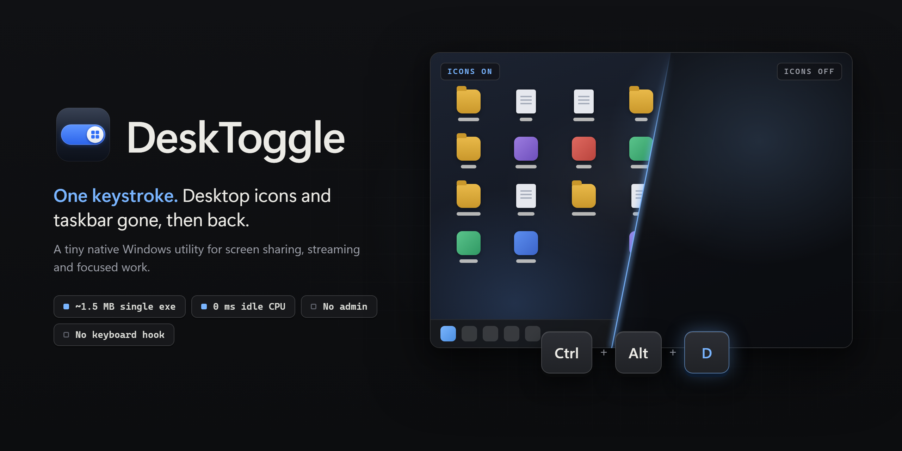
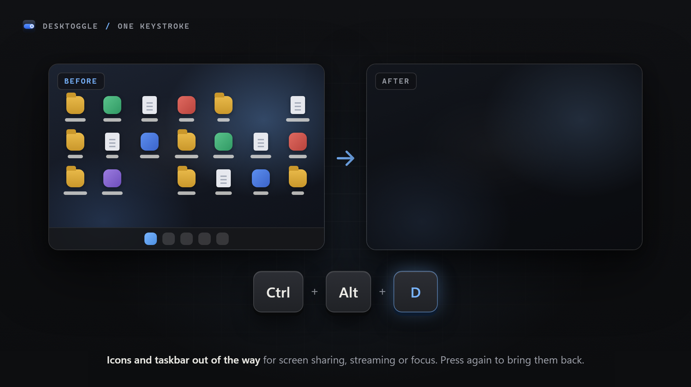
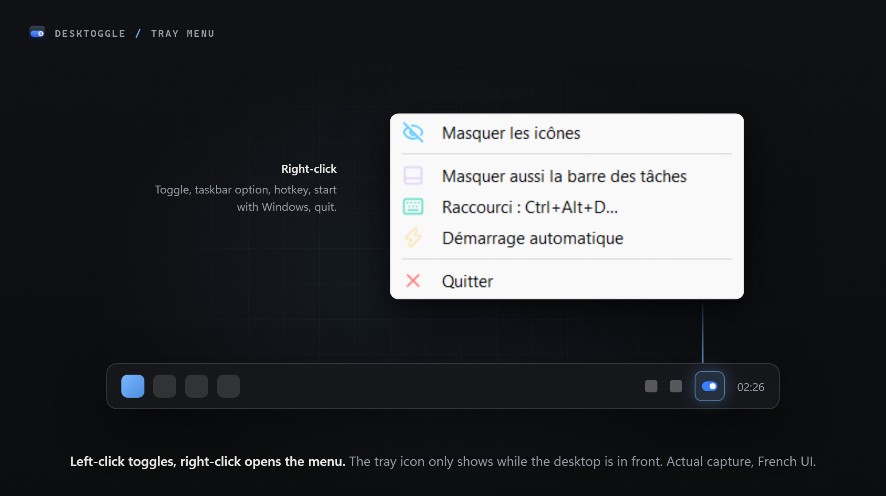
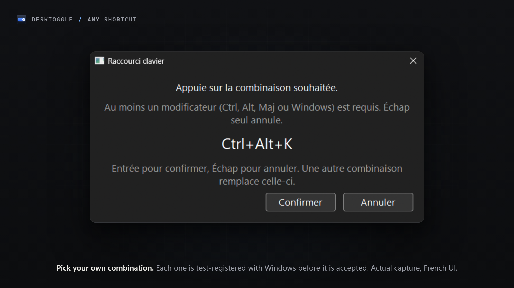
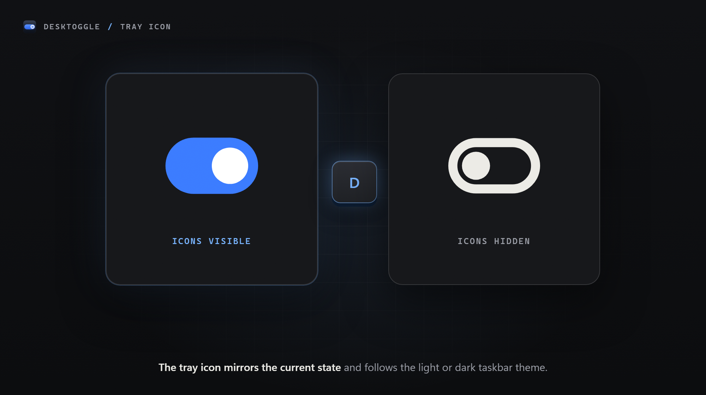

<div align="center">



# DeskToggle

**One keystroke to hide your desktop icons and taskbar. Press it again to bring them back.**<br>
<em>Un raccourci pour masquer les icônes du bureau et la barre des tâches. Un second appui pour les retrouver.</em>

<a href="https://github.com/bhpdev1/DeskToggle/releases/latest"></a>


<br><br>



<a href="#english">English</a> • <a href="#français">Français</a> • <a href="CHANGELOG.md">Changelog</a>

</div>

---

<a name="english"></a>
## English

### Why DeskToggle

You are about to share your screen, start a stream or settle in for focused work, and your desktop is covered in folders, downloads and shortcuts. Windows can hide them, but only through *right-click → View → Show desktop icons*, and the taskbar has its own setting buried somewhere else.

**DeskToggle** turns both into a single keystroke:
- **One hotkey**, `Ctrl+Alt+D` by default, hides the desktop icons. Press it again and they come back.
- **Optional taskbar**: the same keystroke can also switch the taskbar to auto-hide.
- **Nothing is destroyed or rewritten**: DeskToggle drives the same switches Windows already offers, and puts everything back as it found it.
- **Invisible when idle**: a single native executable, no runtime, no installer, no admin rights.

---

### Features

| Feature | What you get |
| :--- | :--- |
| **Global hotkey** | `Ctrl+Alt+D` by default. Change it in a capture dialog; each combination is test-registered with Windows before it is accepted. |
| **Discreet tray icon** | Appears only while the desktop is in front. Left-click toggles, right-click opens the menu. The icon shows the current state. |
| **Taskbar option** | Extends the toggle to the taskbar using Windows' own auto-hide. Your existing auto-hide preference is preserved. |
| **Crash-safe** | Icons and taskbar are restored on every exit path, and repaired on the next launch if the process was ever killed. |
| **Starts with Windows** | One menu entry, per-user. No installer, no admin prompt. |
| **Tiny footprint** | One ~1.5 MB executable, about 3 MB of memory and 0 ms of CPU while idle. No keyboard hook. |

---

### Screenshots

<div align="center">

| One keystroke, before and after | The tray menu |
| :---: | :---: |
|  |  |
| **Pick your own shortcut** | **Tray icon states** |
|  |  |

<sub>Menu and dialog are actual captures. The app's interface is in French only.</sub>

</div>

---

### Installation & Usage

#### Option A: Pre-built executable
1. Download `DesktopIconsToggle.exe` from [Releases](https://github.com/bhpdev1/DeskToggle/releases).
2. Put it anywhere (for example `C:\Tools\`) and run it. The tray icon appears whenever the desktop is in front.
3. Press **`Ctrl+Alt+D`** (or left-click the tray icon) to hide or show the icons.
4. Right-click the tray icon to also hide the taskbar, change the shortcut, or enable **start with Windows**.
5. **Quit** always restores everything before exiting.

If `Ctrl+Alt+D` is already taken, DeskToggle falls back to another combination on first run. The menu always shows the one actually in use.

#### Option B: Build from source
Requires the .NET 10 SDK and, for the NativeAOT publish, the MSVC build tools and Windows SDK (Visual Studio Build Tools).

```powershell
git clone https://github.com/bhpdev1/DeskToggle.git
cd DeskToggle
dotnet test tests/DesktopIconsToggle.Tests
dotnet publish src/DesktopIconsToggle -c Release -r win-x64
```

The executable lands in `src/DesktopIconsToggle/bin/Release/net10.0-windows/win-x64/publish/`. See [CONTRIBUTING.md](CONTRIBUTING.md) for the test rules and [docs/ARCHITECTURE.md](docs/ARCHITECTURE.md) for how it works.

---

### Good to know

- **French-only interface.** Menus and dialogs are in French.
- **Unsigned executable.** SmartScreen warns on first launch after a download: *More info → Run anyway*.
- **Windows-key shortcuts** (`Win+…`) can register yet never fire, because Explorer handles them first. None are offered by default.
- **Taskbar auto-hide is global.** Windows has no per-monitor setting, so it applies to every screen.
- **Manual recovery**, if the app is killed while icons are hidden and never relaunched: right-click the desktop → *View* → *Show desktop icons*.

---

### Under the hood

Native Windows executable built with **.NET 10 NativeAOT**: hand-written Win32 interop, no WinForms or WPF, no runtime to install. It uses Windows' own *Show desktop icons* switch and the taskbar's own auto-hide setting, and stores its preferences per-user. The pure logic is covered by **183 xUnit tests**.

---

### License

DeskToggle is licensed under the **GNU General Public License v3.0**, see [LICENSE](LICENSE). Tray menu icons are derived from [Lucide](https://lucide.dev) (ISC), see [THIRD-PARTY-NOTICES.md](THIRD-PARTY-NOTICES.md).

---

<a name="français"></a>
## Français

### Pourquoi DeskToggle

Vous allez partager votre écran, lancer un stream ou vous concentrer, et votre bureau déborde de dossiers, de téléchargements et de raccourcis. Windows sait les masquer, mais seulement via *clic droit → Affichage → Afficher les éléments du Bureau*, et la barre des tâches a son propre réglage, rangé ailleurs.

**DeskToggle** réunit les deux en un seul raccourci :
- **Un raccourci**, `Ctrl+Alt+D` par défaut, masque les icônes du bureau. Un second appui les fait revenir.
- **Barre des tâches en option** : le même raccourci peut aussi passer la barre en masquage automatique.
- **Rien n'est détruit ni réécrit** : DeskToggle actionne les mêmes réglages que Windows propose déjà, et remet tout comme il l'a trouvé.
- **Invisible au repos** : un seul exécutable natif, sans runtime, sans installeur, sans droits administrateur.

---

### Fonctionnalités

| Fonctionnalité | Ce que vous obtenez |
| :--- | :--- |
| **Raccourci global** | `Ctrl+Alt+D` par défaut. Modifiable dans une fenêtre de capture ; chaque combinaison est testée auprès de Windows avant d'être acceptée. |
| **Icône de notification discrète** | Visible uniquement quand le bureau est au premier plan. Clic gauche pour basculer, clic droit pour le menu. L'icône reflète l'état courant. |
| **Option barre des tâches** | Étend la bascule à la barre via le masquage automatique de Windows. Votre réglage existant est préservé. |
| **Résistant aux plantages** | Icônes et barre restaurées à chaque sortie, et réparées au lancement suivant si le processus a été tué. |
| **Démarrage avec Windows** | Une entrée de menu, par utilisateur. Ni installeur, ni demande d'élévation. |
| **Empreinte minime** | Un exécutable d'environ 1,5 Mo, environ 3 Mo de mémoire et 0 ms de CPU au repos. Aucun hook clavier. |

---

### Captures d'écran

<div align="center">

| Un raccourci, avant et après | Le menu de notification |
| :---: | :---: |
|  |  |
| **Votre propre raccourci** | **États de l'icône** |
|  |  |

<sub>Le menu et la fenêtre sont de vraies captures. L'interface est uniquement en français.</sub>

</div>

---

### Installation & utilisation

#### Option A : exécutable précompilé
1. Téléchargez `DesktopIconsToggle.exe` depuis les [Releases](https://github.com/bhpdev1/DeskToggle/releases).
2. Placez-le où vous voulez (par exemple `C:\Outils\`) et lancez-le. L'icône apparaît dès que le bureau est au premier plan.
3. Appuyez sur **`Ctrl+Alt+D`** (ou clic gauche sur l'icône) pour masquer ou afficher les icônes.
4. Clic droit sur l'icône pour masquer aussi la barre des tâches, changer le raccourci ou activer le **démarrage automatique**.
5. **Quitter** restaure toujours tout avant de fermer.

Si `Ctrl+Alt+D` est déjà pris, DeskToggle se rabat sur une autre combinaison au premier lancement. Le menu affiche toujours celle réellement utilisée.

#### Option B : compiler depuis les sources
Nécessite le SDK .NET 10 et, pour la publication NativeAOT, les outils MSVC et le SDK Windows (Visual Studio Build Tools).

```powershell
git clone https://github.com/bhpdev1/DeskToggle.git
cd DeskToggle
dotnet test tests/DesktopIconsToggle.Tests
dotnet publish src/DesktopIconsToggle -c Release -r win-x64
```

L'exécutable se trouve dans `src/DesktopIconsToggle/bin/Release/net10.0-windows/win-x64/publish/`. Voir [CONTRIBUTING.md](CONTRIBUTING.md) pour les règles de test et [docs/ARCHITECTURE.md](docs/ARCHITECTURE.md) pour le fonctionnement.

---

### À savoir

- **Interface uniquement en français.**
- **Exécutable non signé.** SmartScreen avertit au premier lancement après un téléchargement : *Informations complémentaires → Exécuter quand même*.
- **Les raccourcis avec la touche Windows** (`Win+…`) peuvent s'enregistrer sans jamais se déclencher, car l'Explorateur les intercepte d'abord. Aucun n'est proposé par défaut.
- **Le masquage automatique de la barre est global.** Windows n'offre aucun réglage par écran.
- **Récupération manuelle**, si l'application est tuée pendant que les icônes sont masquées et jamais relancée : clic droit sur le bureau → *Affichage* → *Afficher les éléments du Bureau*.

---

### Sous le capot

Exécutable Windows natif compilé avec **.NET 10 NativeAOT** : interop Win32 écrite à la main, ni WinForms ni WPF, aucun runtime à installer. Il s'appuie sur le réglage *Afficher les éléments du Bureau* de Windows et sur le masquage automatique natif de la barre, et stocke ses préférences par utilisateur. La logique pure est couverte par **183 tests xUnit**.

---

### Licence

DeskToggle est open source sous licence **GNU General Public License v3.0 (GPLv3)**, voir [LICENSE](LICENSE). Les icônes du menu sont dérivées de [Lucide](https://lucide.dev) (ISC), voir [THIRD-PARTY-NOTICES.md](THIRD-PARTY-NOTICES.md).
